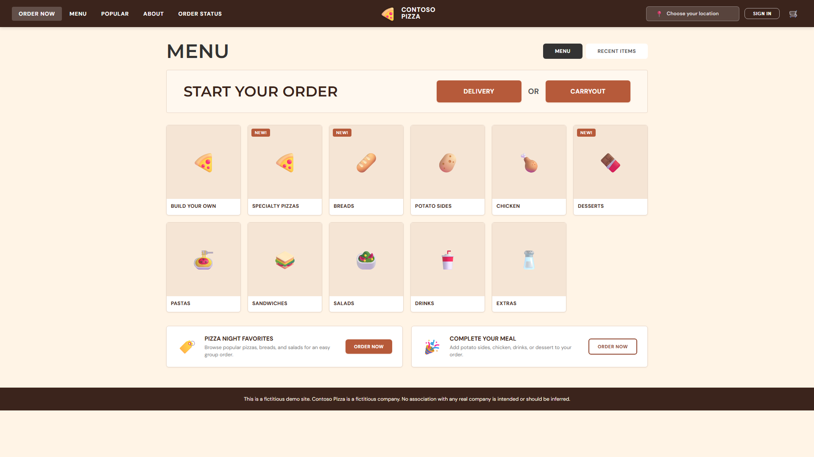

# Contoso Pizza Order Demo (Imperative WebMCP Implementation)

A fictitious Contoso Pizza demo site implementing the [imperative version of WebMCP](https://github.com/webmachinelearning/webmcp), a browser API that enables AI agents to discover and interact with tools exposed by web pages. This example demonstrates a pizza ordering flow where four agentic tools (`browse`, `create-order`, `update-order`, `checkout`) let an AI agent build and revise a complete order in just a few calls.



## 🚀 Live Demo

**[Try it now on GitHub Pages](https://victorhuangwq.github.io/pizza-order-demo/)**

## How to Test It

To test this demo with a real WebMCP implementation:

### Chrome with Experimental Platform Features (EPP)

1. **Read the setup guide:** [WebMCP Chrome Blog Post](https://developer.chrome.com/blog/webmcp-epp)
2. **Follow the setup steps:** [WebMCP Setup Instructions](https://docs.google.com/document/d/1rtU1fRPS0bMqd9abMG_hc6K9OAI6soUy3Kh00toAgyk/edit?tab=t.0)
3. Enable `chrome://flags/#enable-webmcp-testing` or `edge://flags/#enable-webmcp-testing` for local testing, then relaunch the browser.
4. **Open the live demo** in your configured browser.
5. The site will automatically register its WebMCP tools (`browse`, `create-order`, `update-order`, `checkout`).

### Browser Compatibility

| Browser | Status | Notes |
|---------|--------|-------|
| Chrome 146+ | 🧪 Preview | Requires EPP access, an active origin trial, or the WebMCP testing flag |
| Edge 146+ | 🧪 Preview | Requires EPP access, an active origin trial, or the WebMCP testing flag |

## How It Works

The site exposes four high-level WebMCP tools via `document.modelContext.registerTool()`. An AI agent can complete an entire order in as few as three tool calls:

| Tool | Purpose |
|------|---------|
| `browse` | Returns the full menu (products, sizes, crusts, toppings, pricing rules) as structured JSON. Shows an agent-working modal to the user. |
| `create-order` | Accepts order type, address, and an array of items (with optional pizza customization). Builds a cart and navigates to checkout in one call. |
| `update-order` | Adds or removes products and changes quantities in an existing cart. |
| `checkout` | Collects customer contact info, prompts the user for confirmation, and places the order. |

`browse` and `create-order` are always registered. `update-order` becomes available once the cart is populated, and `checkout` becomes available once the UI reaches checkout.

## Local Development

Run the site locally with npm:

```bash
npm install
npm start
```

Then open **http://localhost:3000** in your browser.

> This is a fictitious demo site. Contoso Pizza is a fictitious company. No association with any real company is intended or should be inferred.

## Project Structure

```
.
├── index.html             # Single-page wizard (all 7 steps)
├── css/
│   └── style.css          # Styling
├── js/
│   ├── app.js             # Wizard logic and state management
│   ├── menu-data.js       # Unified product catalog & customization options
│   └── webmcp-tools.js    # WebMCP tool definitions and dynamic registration
├── server.js              # Local dev server
└── package.json
```

## For Developers

### Deployment

This site is automatically deployed to GitHub Pages via GitHub Actions whenever changes are pushed to the `main` branch. No manual configuration needed.

To view deployment status:
- Go to [Actions tab](https://github.com/victorhuangwq/pizza-order-demo/actions)
- Check the "Deploy to GitHub Pages" workflow
